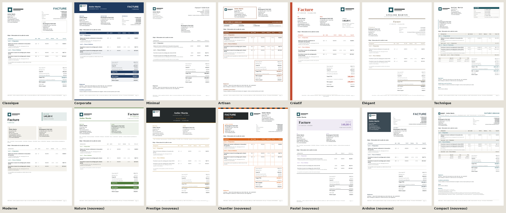

# DevisMinute

Application iPhone de devis, de facturation et de gestion commerciale simplifiée pour les professionnels français. Native (Swift, SwiftUI, SwiftData), entièrement hors ligne, sans serveur, sans abonnement et sans dépendance payante.

> **État du projet (14/10/2026).** Le moteur métier et le générateur PDF sont testés (94 tests, sous Linux et macOS). L'application iOS **compile dans Xcode** et ses 7 tests d'intégration passent sur simulateur (intégration continue GitHub Actions, `macos-15`, SDK iOS 26.2). L'interface **n'a pas encore été utilisée manuellement** sur simulateur ni sur iPhone : voir « Reste à faire » dans [docs/BUILD.md](docs/BUILD.md).

## Organisation du dépôt

| Dossier | Contenu |
|---|---|
| `DevisMinuteKit/` | Package Swift indépendant de l'interface. `DevisCore` : modèles, calculs en `Decimal`, numérotation, statuts, conformité, sceaux d'intégrité, sauvegarde chiffrée, CSV, statistiques, rentabilité, export CII. `DevisPDF` : moteur PDF en Swift pur et les 14 modèles de documents. |
| `DevisMinute/` | Application iOS : SwiftUI, persistance SwiftData, StoreKit 2, ressources. |
| `DevisMinuteTests/` | Tests d'intégration de l'application (base SwiftData en mémoire). |
| `DevisMinute.xcodeproj` | Projet Xcode 16 (dossiers synchronisés). `project.yml` permet de le régénérer avec XcodeGen si besoin. |
| `Config/` | Droits (protection des données), configuration StoreKit de test. |
| `docs/` | Documentation complète. |

## Les 14 modèles de documents



De gauche à droite : Classique, Corporate, Minimal, Artisan / Créatif, Élégant, Technique, Moderne (rendus réels du moteur PDF).

## Documentation

- [Architecture](docs/ARCHITECTURE.md)
- [Règles de calcul et d'arrondi](docs/CALCULS.md)
- [Compilation et tests](docs/BUILD.md)
- [Publication sur l'App Store](docs/PUBLICATION.md)
- [Fiche App Store (textes, mots-clés, captures)](docs/FICHE_APP_STORE.md)
- [Guide utilisateur](docs/GUIDE_UTILISATEUR.md)
- [Conformité : règles appliquées et limites à faire vérifier](docs/CONFORMITE.md)
- [Format et sécurité des sauvegardes](docs/SAUVEGARDE.md)

## Démarrage rapide

```bash
# Moteur métier (macOS ou Linux, Swift 5.10+)
swift test --package-path DevisMinuteKit

# Application (macOS, Xcode 16 ou plus récent)
open DevisMinute.xcodeproj
```
