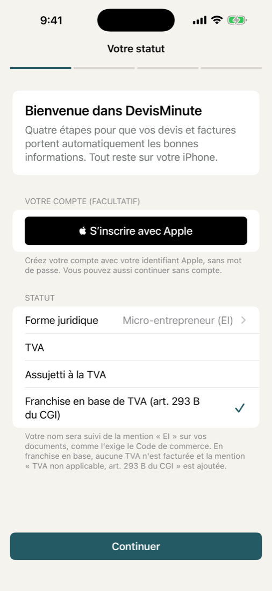
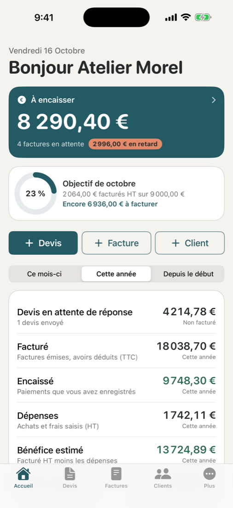
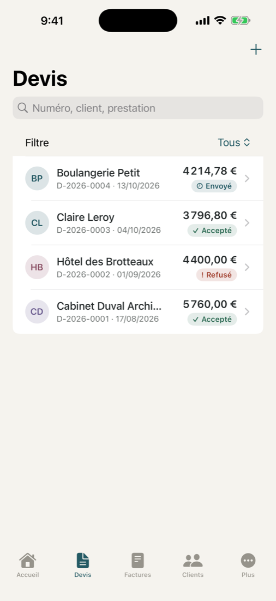
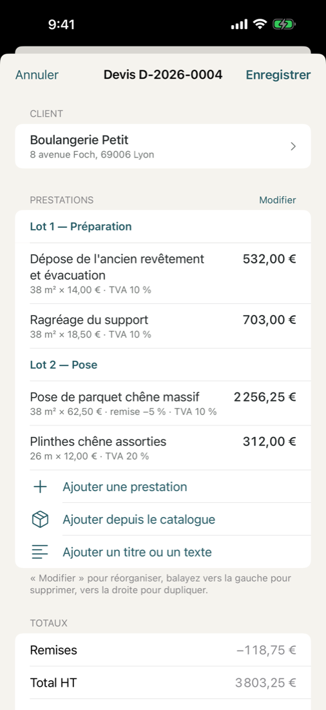
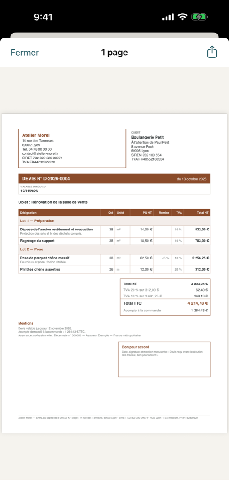
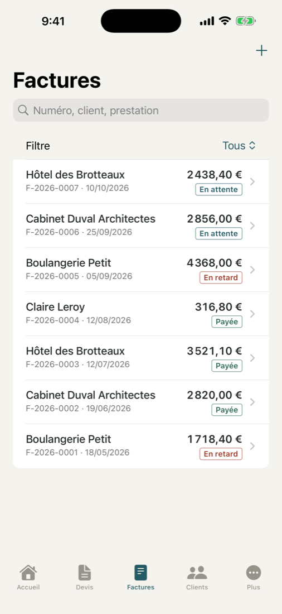
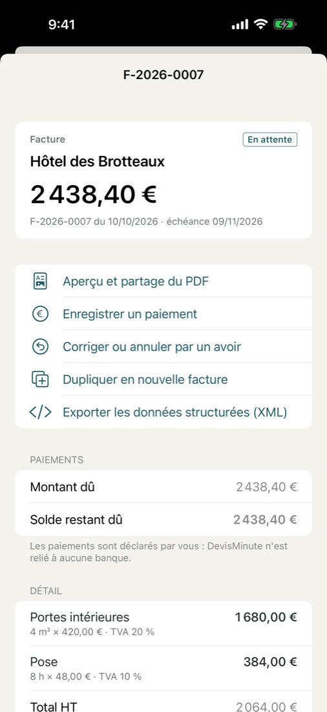
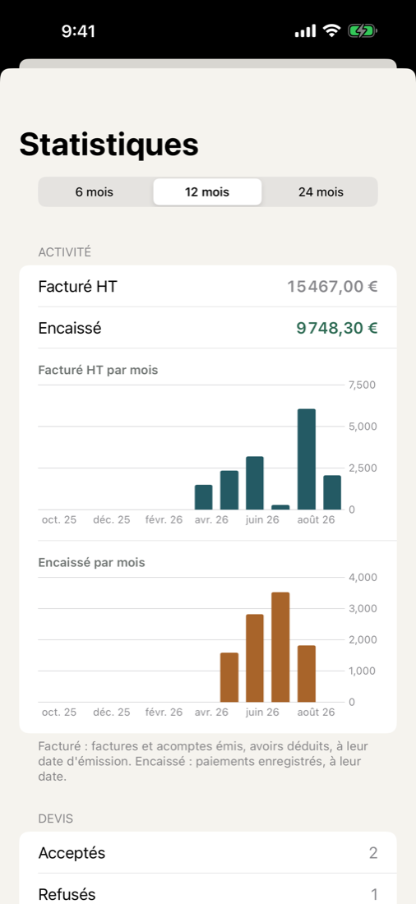
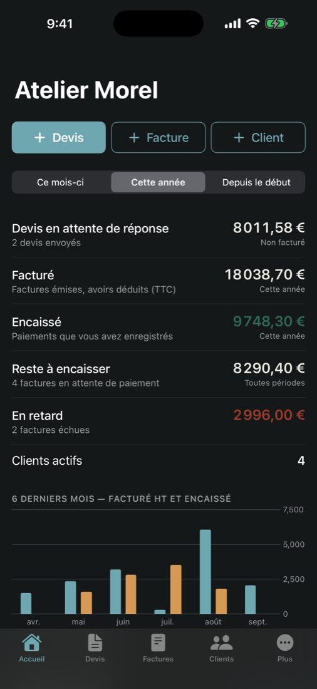

# DevisMinute : récapitulatif du projet

*Rédigé le 15/10/2026 pour partager l'avancement du projet avec toutes les personnes impliquées.*

## 1. L'idée

Une application iPhone qui permet aux indépendants français (artisans, micro-entrepreneurs, freelances, petites entreprises) de créer rapidement des **devis et des factures**, de suivre les **paiements** et de tenir un **répertoire clients**. Objectif commercial : l'App Store, soit en application payante à environ 9,99 €, soit gratuite avec un déblocage par achat unique. Pas d'abonnement, pas de publicité.

Les contraintes du cahier des charges de départ :
- application native (Swift / SwiftUI), qui fonctionne **entièrement hors ligne**, les données restent sur l'iPhone ;
- **aucun serveur, aucune API payante, aucune IA**, aucun coût récurrent ;
- un design professionnel et sobre (fond ivoire, bleu pétrole, anthracite, sans effets gadgets) ;
- **premier devis en moins de 2 minutes** une fois l'entreprise configurée ;
- un vrai sérieux sur les **règles françaises** (mentions obligatoires, numérotation, TVA, avoirs, réforme de la facturation électronique).

## 2. Ce qui existe aujourd'hui

| Partie | État |
|---|---|
| Moteur de calcul (montants exacts, TVA par taux, remises, acomptes, paiements) | ✅ fait et testé |
| Numérotation des factures (chronologique, sans trou), factures émises verrouillées, avoirs | ✅ fait et testé |
| Contrôle des mentions obligatoires avant d'émettre une facture | ✅ fait et testé |
| Générateur de PDF, **8 modèles** (Classique, Corporate, Minimal, Artisan, Créatif, Élégant, Technique, Moderne) | ✅ fait et testé |
| Application iPhone : accueil, devis, factures, clients, catalogue, statistiques, rentabilité, réglages, sauvegarde | ✅ écrite, compile, se lance sur le simulateur |
| Sauvegarde chiffrée + restauration vérifiée, exports et imports CSV | ✅ fait et testé |
| Documentation (compilation, publication App Store, guide utilisateur, conformité) | ✅ dans le dossier `docs/` |
| **Essai à la main sur un vrai iPhone** | ❌ pas encore fait |

Au total, 101 tests automatiques passent, et ils sont relancés à chaque modification (GitHub Actions).

## 3. Captures d'écran

L'application sur un simulateur d'iPhone, avec des données fictives.

| | | |
|---|---|---|
|  |  |  |
| Assistant de configuration | Accueil | Liste des devis |
|  |  |  |
| Éditeur de devis | Aperçu du PDF | Factures |
|  |  |  |
| Fiche d'une facture | Statistiques | Mode sombre |

Les 8 modèles de PDF :

## 4. Points importants à connaître

- **Facturation électronique** : depuis le 1er septembre 2026, toute entreprise doit pouvoir *recevoir* des factures électroniques via une plateforme agréée. À partir du 1er septembre 2027, les PME et micro-entrepreneurs devront aussi les *émettre* par ce biais. L'application crée des PDF et **n'est pas reliée à une plateforme agréée**. Il faudra donc la présenter honnêtement comme un outil de devis et factures, pas comme une solution de « facturation électronique ». Détails : [docs/CONFORMITE.md](docs/CONFORMITE.md).
- **Suivi des paiements** : pour les entreprises qui facturent la TVA et vendent à des particuliers, une question se pose autour de la règle sur les « logiciels de caisse certifiés ». À vérifier avec un expert-comptable.
- **Code visible** : le dépôt GitHub est actuellement **public**. Avant de commercialiser, il vaudra peut-être mieux le passer en privé.

## 5. Ce qu'il reste à faire

1. Tester l'application à la main sur un Mac (Xcode), puis sur un vrai iPhone.
2. Corriger deux petits défauts repérés sur les captures :
   - l'assistant de configuration coupe les libellés trop longs ;
   - une erreur dans les données de démonstration (ne concerne que les fausses données).
3. Créer un compte Apple Developer (99 €/an), une icône définitive et une page de confidentialité.
4. Faire relire les mentions légales par un expert-comptable.
5. Choisir le modèle commercial et le prix.

## 6. Questions à trancher ensemble

- Payante à 9,99 €, ou gratuite avec un achat unique ? Si gratuite, qu'est-ce que la version gratuite doit inclure ?
- Quel utilisateur viser en premier (artisans du bâtiment, freelances, tout le monde) ?
- Vaut-il la peine de se connecter plus tard à une plateforme agréée de facturation électronique ? Ce service serait payant.
- Qui a un Mac pour tester et publier ?

## 7. Où trouver quoi

- Le code complet : ce dépôt (`DevisMinute/` pour l'application, `DevisMinuteKit/` pour le moteur).
- [Guide utilisateur](docs/GUIDE_UTILISATEUR.md) : le fonctionnement de l'application, écran par écran.
- [Publication sur l'App Store](docs/PUBLICATION.md) et la [proposition de fiche App Store](docs/FICHE_APP_STORE.md).
- [Compilation](docs/BUILD.md) : comment compiler et tester.
